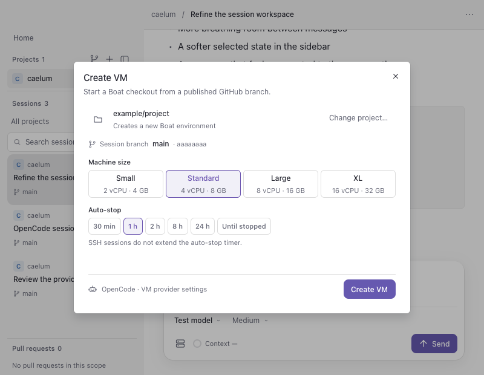
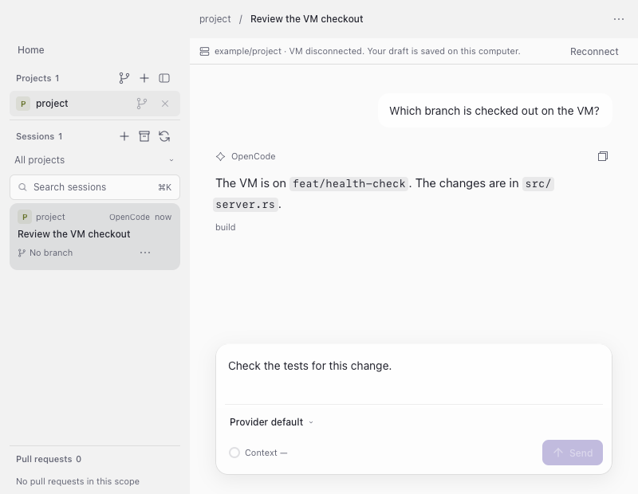
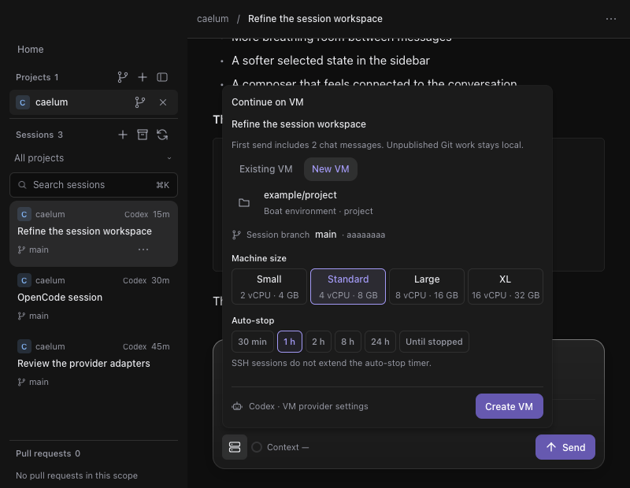

# Run Codex or OpenCode on Boat

A remote machine has its own Git checkout and disk. Its managed VM chat sends messages to
[Boat’s integrated Codex and OpenCode agents](https://docs.boat.dev/platform-guide/agents.md).
Set each provider’s default model and credentials in [Boat → Agents & Proxying](https://boat.dev/dashboard?tab=agents).
The VM composer can override that default for a chat. The local model,
reasoning effort and primary agent (Build, Plan or custom) do not transfer. There is no
additional install for managed chat. You can also open the checkout as a native Caelum workspace over SSH.

## Create or attach a checkout

1. Connect GitHub and credentials for the provider you want to use in your
   [Boat account](https://docs.boat.dev/integrated-agents/keys.md). In Caelum,
   open **Settings → Remote machines**, enter your Boat API key and click
   **Connect Boat**. The key is stored in Keychain or Linux Secret Service.
2. Click **Create VM…** in **Settings → Remote machines** or **New session**.
   Use the current project, choose another, or open a project folder with a GitHub `origin`.
3. **Start from** defaults to the published origin default branch, or `main`.
   Enter a different **New branch on VM** name, choose the [machine size](https://docs.boat.dev/machines.md)
   and auto-stop, then click **Create VM**. Creation prepares the checkout;
   your first **Send** starts the conversation.
   Caelum provisions the repository using a compatible single-repo
   environment or creates a dedicated one. Unpublished commits, staged changes
   and files on your laptop stay there.

To attach instead, right-click a project, choose **Open on remote machine…**,
and choose the machine under **Existing VM**. It must have a
current single-repo environment for the project's GitHub origin. **Resume** a
stopped machine to use its saved disk; attaching keeps its current branch.
If setup fails, **Refresh checkout** retries that checkout on the same machine.

## Open a native workspace

On a running, ready checkout, click **Open native workspace** above the VM
transcript, or choose it from the VM’s sidebar menu. A separate Caelum window
opens on the VM checkout. Start with OpenCode, or choose Codex in **New session**.
The normal session list, model and effort pickers, transcript, questions,
approvals and background-shell output use the provider installed on the VM.
**Files** and **Changes** read that checkout. Opening a window or switching
sessions does not submit a message.

The Boat key needs the [`ssh` action](https://docs.boat.dev/ssh-access).
Caelum installs its matching Linux peer on first use and uses the VM’s own
provider configuration and credentials. Drafts and session settings are kept
on this computer, separately for each account, machine and repository. The
managed conversation, including any handoff draft, stays in its original window.

If SSH drops, you can keep editing. Caelum tries to reconnect once; if the VM
has stopped, **Resume** it in the original window and click **Reconnect** in
the native one. The connection verifies the new host key, reloads history and
restores pending questions and approvals. Check the transcript before retrying
a message marked unconfirmed. Closing the window detaches; it does not stop
the VM. SSH activity does **not** extend Boat’s auto-stop timer.

## Connected, but Create VM returns 403

Connecting checks that the key can read the account and list VMs. Creating a VM
needs `sandbox.create` for its environment. **First-time repository setup also
needs `environment.write`** to create and configure the Boat environment.

- If Caelum reports **Create checkout environment** or **Configure checkout
  environment** and your key lacks `environment.write`, create a scoped key
  with your current permissions plus `environment.write` in [Boat → API Keys](https://boat.dev/dashboard?tab=api-keys).
  Enter it in **Settings → Remote machines → Connect Boat** for the same
  account. Reopen **one** failed checkout, or click **Refresh checkout** if it’s
  already open, to retry its original request.
- To keep a key without `environment.write`, configure an [environment in Boat](https://docs.boat.dev/environments/repositories.md)
  with just this repository, GitHub access and agent credentials enabled, and
  **Safe for third parties** off. Reopen VM setup so Caelum discovers it. The
  key still needs `environment.read` and `sandbox.create` for that environment,
  `exec` to prepare the checkout, and `agent.prompt` to send a prompt.

If the failing step is **Create VM**, check the action **and** the key’s allowed
environments, or follow the size restriction in the error. See [Boat key scopes](https://docs.boat.dev/api-keys/scopes.md).

## Continue a local session on a VM

Click the **server icon** beside **Context** in a local Codex or OpenCode composer.
On **Home** it’s beside **Send**. The picker opens at the icon; on Home, choose the
Home draft or a recent session. Finish any active local turn and queued prompts first.

For a handoff, **Session branch** is the current branch of that session’s exact
worktree (or Home’s chosen checkout). A new VM opens **that same branch** at
its published commit on `origin`. The name is shown for reference; there’s
nothing to enter. An existing VM keeps its branch and must already contain the
published commit.

Choose an existing VM, or choose the size and auto-stop time and click
**Create VM**. While Boat prepares the checkout, a progress card takes the
place of the message editor. The editor returns with a copy of your unsent draft.
Your original session and draft stay on the laptop.
If the VM already had a conversation, **Conversations…** switches back to it.

The first time you press **Send**, Caelum includes the local user and assistant
messages as context for a new Boat conversation. The VM composer starts with
the provider from your local session or Home draft. Setup shows how much chat
will travel: up to the most recent 200 messages or 64 KiB of text. Tool output,
reasoning, attachments and unpublished Git work stay local.

## Work on the VM

**Before your first Send**, open **Boat default** beside **Codex** or **OpenCode**
in the VM composer. Search [Boat’s model catalogue](https://docs.boat.dev/integrated-agents/harnesses-and-models.md#the-model-catalog)
and choose a model your Boat credentials support. You can change your choice
while drafting, including after a local handoff. Only **Send** starts the
conversation, using the last choice you made.

Each VM chat remembers its choice. Between turns you can pick another model in
the same conversation. Changing providers resets the model to **Boat default**.
That option uses your Boat settings and works even when the catalogue can’t load.

To change reasoning depth, choose a specific model, then open **Effort** beside
it. The menu lists only the levels Boat advertises for that provider and model.
For example, you can choose **High** before the first Send, then choose a lower
level for a follow-up without leaving the conversation.

**Boat default** in the effort menu lets Boat choose the level. **None**, when
listed, explicitly requests no extra reasoning. Changing model or provider
resets effort; switching away from a chat and back keeps its choice. The model
setting **Boat default** leaves both decisions to your account. Models that
list no effort levels have no effort picker.

Reopen Caelum or select the machine’s sidebar row to continue the same thread.
If Boat may have accepted a prompt but the acknowledgement was lost, check
Boat and reconnect using the prompt ID.

When the VM is ready and its turn has finished, choose **Conversations… →
New session on this VM**, or right-click the VM in the sidebar. **Sessions**
immediately selects the new chat and keeps the previous chat in the list.
Click either row to return to its draft. Both use the same VM files and branch.
Only **Send** starts the new Boat conversation.

You can also open **New session** (**⇧⌘N**), choose a provider, and select a
checkout under the project’s **Remote VMs**. Search by VM name, repository or
branch. From an open, idle VM, **⌘N** starts a fresh session with its current provider.

To switch providers in an existing chat, finish the current turn, then choose
**Codex** or **OpenCode** in the VM composer. The next **Send** uses that provider
in the same [Boat conversation](https://docs.boat.dev/integrated-agents/conversations.md#switch-harness-or-model-in-a-conversation).
Your draft stays in the editor, and earlier replies keep their original provider labels.

### See what the agent is doing

Look in the VM transcript while a turn runs. **Working on VM…** means the turn
is active but hasn’t reported a more specific action. Tool calls show their
name, status and, when available, the file or executable. Click a tool row to
see its command and text result or error. An open call updates when its result
arrives. You can reopen it after restarting Caelum as long as Boat retains the
event. Older saved rows without an event reference show their summary only.

Boat’s [managed event feed](https://docs.boat.dev/api/reference/agent/list-sandbox-events.md)
publishes replies and tool calls. It doesn’t guarantee a separate thinking
stream. If a response includes a public reasoning-summary item, Caelum shows
**Thinking…** while it’s active; click the row to read the summary. A high
effort setting alone doesn’t mean a summary is available.

### Resume or manage the machine

If you used the earlier direct-OpenCode preview,
its VM transcript and draft stay available for reference. Your next explicit
send starts a managed conversation; opening the checkout does not replay a turn.
Caelum no longer contacts the preview service. If one is still running on an
old VM, stopping that VM ends its detached process.

Find the checkout under **Remote VMs** in the project sidebar. **Stop** in the
composer interrupts just the selected turn. **Stop machine** keeps the disk
for a later resume. **Delete VM on Boat…** permanently deletes the machine and
its disk. Confirm its exact name and ID; Caelum removes the chats, drafts and
links only after Boat accepts deletion. If it fails, the checkout stays available
to retry. The key needs `sandbox.delete` or `sandbox.delete-own` for a VM it
created. A setup that has no Boat machine ID can only be discarded locally.

Click the server icon in the remote composer or the original linked session for
machine stats: capacity, the auto-stop deadline, and the busiest sampled process.
From the original session, **Open VM conversation** returns to its specific
thread. **Pin stats to VM composer** keeps process activity visible on the VM.

The default lifetime is **1 h**. For longer work, choose **8 h**, **24 h**,
or **Until stopped**. Boat automatically moves a timed VM’s deadline forward
while a managed Boat prompt is running or waiting, even if Caelum is closed.
Standalone commands and services don’t renew it. In machine stats, **Set from
now** changes the remaining time without interrupting the turn. **Until stopped**
keeps billing until you stop the VM; trials require a timer of at most 2 h.
See [Boat’s auto-stop guide](https://docs.boat.dev/long-running-tasks/auto-stop.md).

Open **Changes** from machine stats on the VM or **View remote changes** from the workspace
menu. Review and commit the VM's tracked and non-ignored new files; **Push
branch** publishes the reviewed commit to GitHub. In your local project, run
`git fetch origin` to bring the branch back.
